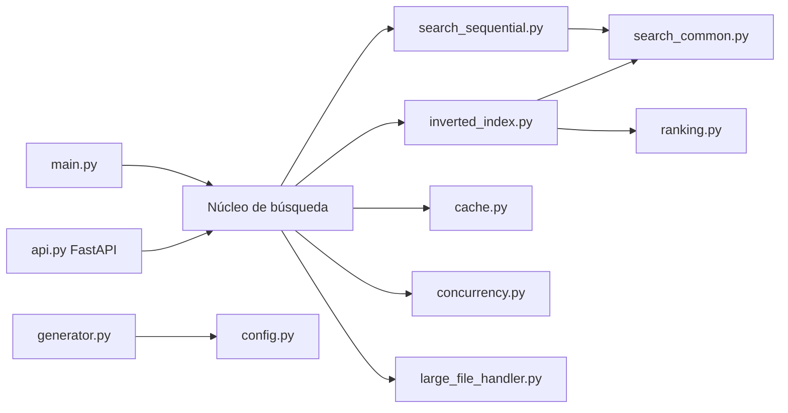

# Parcial 3 — Documentación externa e Integración Continua

**Materia**: Programación Eficiente  
**Proyecto**: Buscador Eficiente de Información  
**Integrantes**: [completar nombres]  
**Repositorio**: [completar URL de GitHub]  
**Sitio publicado**: [completar URL de GitHub Pages]  
**Fecha**: noviembre de 2026

---

## 1. Resumen

Se implementó la documentación externa del buscador con **MkDocs + Material for
MkDocs + mkdocstrings + Mermaid**, versionada en `documentation/` y publicable en
GitHub Pages. Además, se implementó un pipeline de **GitHub Actions** que ejecuta
controles de pruebas, cobertura, análisis estático, tipado, complejidad,
seguridad, dependencias, documentación, benchmarks, profiling y memoria.

Todos los controles pueden reproducirse localmente con un único comando:

```bash
make ci
# o
bash scripts/run_ci_locally.sh
```

La ejecución local completa finalizó correctamente con **60 pruebas aprobadas**,
**95.17% de cobertura**, **Pylint 10.00/10**, **0 vulnerabilidades conocidas**,
**0 secretos detectados** y **0 enlaces internos rotos**.

> **Estado**: implementación local completa y validada. La publicación remota
> (repositorio, GitHub Pages y protección de rama) queda pendiente porque este
> entorno no tiene credenciales ni repositorio remoto. Los pasos exactos están
> en la sección 9.

---

## 2. Documentación externa

### 2.1 Herramienta elegida

| Aspecto | Implementación |
|---|---|
| Herramienta | MkDocs 1.6.1 + Material for MkDocs 9.8.0 |
| Referencia de API | mkdocstrings + mkdocstrings-python |
| Diagramas | Mermaid |
| Fuente | Markdown en `documentation/` |
| Configuración | `mkdocs.yml` |
| Publicación | GitHub Pages mediante `.github/workflows/pages.yml` |
| Control de acceso | Repositorio privado + colaboradores + protección de `main` |
| Validación | `mkdocs build --strict` + Lychee |

### 2.2 Contenido mínimo exigido

| Contenido | Página | Estado |
|---|---|---|
| Descripción funcional, alcance y requisitos | [`descripcion-funcional.md`](documentation/descripcion-funcional.md) | Completo |
| Arquitectura, módulos, responsabilidades, dependencias y diagrama | [`arquitectura.md`](documentation/arquitectura.md) | Completo |
| Instalación y ejecución | [`instalacion.md`](documentation/instalacion.md) | Completo |
| Diseño técnico, estructuras, algoritmos y decisiones | [`diseno-tecnico.md`](documentation/diseno-tecnico.md) | Completo |
| API y contratos, entradas, salidas, excepciones y ejemplos | [`api.md`](documentation/api.md) | Completo |
| Pruebas: estrategia, casos y resultados | [`pruebas.md`](documentation/pruebas.md) | Completo |
| Rendimiento: benchmarks, profiling, complejidad y memoria | [`rendimiento.md`](documentation/rendimiento.md) | Completo |
| Seguridad: riesgos, dependencias y medidas correctivas | [`seguridad.md`](documentation/seguridad.md) | Completo |
| Mantenimiento: contribución, controles y resolución de fallos | [`mantenimiento.md`](documentation/mantenimiento.md) | Completo |
| Cómo ejecutar localmente los mismos controles del CI | [`ci.md`](documentation/ci.md) y [`mantenimiento.md`](documentation/mantenimiento.md) | Completo |
| Glosario y ADR | [`glosario.md`](documentation/glosario.md), [`adr/`](documentation/adr/) | Completo |

### 2.3 Diagrama de componentes



La documentación amplía este diagrama con dependencias, flujo de búsqueda y
construcción del índice.

---

## 3. Integración Continua

### 3.1 Plataforma y disparadores

- Plataforma: **GitHub Actions**.
- Workflow principal: `.github/workflows/ci.yml`.
- Disparadores: `push` a `main` y `develop`, `pull_request` a `main`,
  `schedule` semanal y `workflow_dispatch`.
- Concurrencia: cancela ejecuciones anteriores de la misma rama.
- Permisos: `contents: read`; el job de seguridad agrega
  `security-events: write`.

### 3.2 Matriz de controles

| Control | Herramienta | Comando reproducible | Reporte | Criterio de rechazo |
|---|---|---|---|---|
| Pruebas | pytest | `pytest -q --junitxml=reports/junit.xml` | JUnit XML | ≥ 1 prueba fallida |
| Cobertura | pytest-cov | `pytest --cov --cov-report=xml` | XML + HTML | < 80% |
| Benchmark | pytest-benchmark | `pytest benchmarks --benchmark-json=reports/benchmark.json` | JSON | Regresión > 50% en `main` |
| Profiling CPU | cProfile + pyinstrument | `python scripts/profile_cpu.py` | TXT, PROF, HTML | Informativo |
| Análisis estático | Ruff | `ruff check .` + `ruff format --check .` | Anotaciones | Cualquier violación |
| Diseño | Pylint | `pylint --rcfile=.pylintrc ...` | Texto | Score < 8.0 |
| Complejidad | Radon | `python scripts/check_complexity.py` | JSON CC + MI | Bloque ≥ C o MI < 20 |
| Tipado | mypy | `mypy` | Texto | Cualquier error en el núcleo |
| Memoria | tracemalloc | `python scripts/measure_memory.py` + `check_memory.py` | JSON | > `min(256 MB, 1.5× base)` en `main` |
| Código inseguro | Bandit | `bandit -r . ... -lll -iii` | JSON | HIGH/HIGH |
| Dependencias | pip-audit | `pip-audit -r requirements.txt` | JSON | Cualquier CVE en ejecución |
| Secretos | Gitleaks | `gitleaks git` | SARIF | Cualquier secreto |
| Documentación | MkDocs | `mkdocs build --strict` | Sitio HTML | Warning o error |
| Enlaces | Lychee | `lychee --offline documentation/**/*.md` | Texto | Enlace interno roto |
| Actualizaciones | Dependabot | `.github/dependabot.yml` | Pull requests | Revisión humana |

### 3.3 Etapas del pipeline

| Etapa | Job | Depende de | Contenido |
|---|---|---|---|
| 1. Integración | — | — | Push o pull request. |
| 2. Preparación | `preparacion` | — | Dependencias fijadas, `pip check`, `compileall`. |
| 3. Calidad estática | `calidad-estatica` | preparación | Ruff, formato, mypy, Pylint, Radon. |
| 4. Pruebas y cobertura | `pruebas-cobertura` | preparación | Matriz Python 3.11, 3.12 y 3.13. |
| 5. Seguridad | `seguridad` | preparación | Bandit, pip-audit y Gitleaks (SARIF). |
| 6. Documentación | `documentacion` | preparación | MkDocs strict y Lychee. |
| 7. Rendimiento y memoria | `rendimiento-memoria` | pruebas | Benchmarks, memoria y profiling. |
| 8. Resultado final | `resultado-final` | todas | Consolidación y artefactos. |

Las etapas 3 a 6 se ejecutan en paralelo. Rendimiento espera a las pruebas para
no competir por CPU con la matriz. El resultado final falla si cualquier etapa
falló o fue cancelada.

### 3.4 Política de bloqueo

| Condición | ¿Bloquea? |
|---|---|
| Prueba fallida | Sí |
| Cobertura < 80% | Sí |
| Ruff con violaciones | Sí |
| Pylint < 8.0 | Sí |
| mypy con errores en el núcleo | Sí |
| Complejidad ≥ C o MI < 20 | Sí |
| Bandit HIGH/HIGH | Sí |
| Secreto detectado | Sí |
| CVE en dependencias de ejecución | Sí |
| Documentación no compila o enlace roto | Sí |
| Benchmark con regresión > 50% en `main` | Sí |
| Memoria fuera de límite en `main` | Sí |
| Benchmark o memoria en pull request | No, informativo |

La política completa está en [`documentation/ci.md`](documentation/ci.md) y en
[`documentation/adr/0004-ci-quality-gates.md`](documentation/adr/0004-ci-quality-gates.md).

---

## 4. Evidencia de ejecución local

### 4.1 Pruebas y cobertura

```text
60 passed, 1 warning
TOTAL 409 statements, 18 missed, 88 branches, 4 partial
Coverage: 95.17%
Required test coverage of 80.0% reached.
```

| Módulo | Cobertura |
|---|---|
| `api.py` | 100% |
| `cache.py` | 95% |
| `concurrency.py` | 86% |
| `generator.py` | 100% |
| `inverted_index.py` | 96% |
| `large_file_handler.py` | 80% |
| `search_common.py` | 100% |

### 4.2 Calidad estática

| Control | Resultado |
|---|---|
| Ruff | Sin hallazgos; 45 archivos formateados. |
| mypy | Sin errores en 10 archivos del núcleo. |
| Pylint | **10.00/10**. |
| Radon CC | Todos los bloques en rango **A/B**. |
| Radon MI | Mínimo **51.94** (`search_common.py`), umbral 20. |

### 4.3 Seguridad

| Control | Resultado |
|---|---|
| Bandit | 0 HIGH/HIGH; 9 LOW documentados como falsos positivos. |
| pip-audit (ejecución) | Sin vulnerabilidades conocidas. |
| pip-audit (desarrollo) | Sin vulnerabilidades conocidas. |
| Gitleaks | 0 secretos detectados. |

Falsos positivos registrados en `SECURITY.md`:

| ID | Herramienta | Hallazgo | Justificación |
|---|---|---|---|
| FP-001 | Bandit B311 | `random.Random` en `generator.py` | Corpus sintético reproducible; no se usa en seguridad. |
| FP-002 | Bandit B404/B603 | `subprocess` en herramientas internas | Argumentos en lista, sin `shell=True` ni entrada de usuario. |

### 4.4 Documentación

| Control | Resultado |
|---|---|
| `mkdocs build --strict` | Sitio generado sin warnings de validación (el tema muestra un aviso informativo de fin de vida). |
| Lychee | 22 enlaces, 17 OK, 0 errores, 5 excluidos. |

### 4.5 Rendimiento

Mediana de la línea base (`benchmarks/baseline.json`):

| Operación | Mediana |
|---|---|
| `tokenize` | 1.732 ms |
| Construcción de índice (200 docs) | 12.290 ms |
| Búsqueda secuencial | 0.489 ms |
| Búsqueda indexada | 1.363 µs |
| Búsqueda cacheada | 0.339 µs |
| Lectura por buffer | 25.879 µs |

La ejecución de verificación comparó los valores actuales contra la línea base
con tolerancia del 50%: todas las operaciones quedaron dentro del rango
(máximo observado 1.18×).

### 4.6 Memoria

| Escenario | Pico | Límite |
|---|---|---|
| Construcción de índice | 3.80 MB | 5.71 MB |
| Carga secuencial | 2.27 MB | — |
| Lectura de archivo grande | 0.13 MB | — |

### 4.7 Profiling

`reports/profile.txt` muestra que la construcción del índice está dominada por
`add_document` y `re.split` durante la tokenización. El detalle y la
interpretación están en [`documentation/rendimiento.md`](documentation/rendimiento.md).

---

## 5. Seguridad: riesgos y medidas

| Riesgo | Medida |
|---|---|
| Inyección de comandos | Listas de argumentos, sin `shell=True`; Bandit. |
| Dependencia vulnerable | pip-audit y Dependabot. |
| Secreto versionado | Gitleaks y rotación. |
| API expuesta sin autenticación | Escuchar en `127.0.0.1`; proxy autenticado si se publica. |
| Consultas gigantes | `max_length=200` en FastAPI. |
| Path traversal | Solo se listan archivos `documento_*.txt`; no se aceptan rutas. |

La política de severidad y el registro de excepciones están en `SECURITY.md`.

---

## 6. Cómo ejecutar los controles localmente

```bash
python3.11 -m venv .venv
source .venv/bin/activate
pip install -r requirements.txt -r requirements-dev.txt -r requirements-docs.txt

python scripts/generate_corpus.py --docs 200 --large 1 --seed 42
make ci
```

Equivalencias:

```bash
make lint       # Ruff + Pylint
make types      # mypy
make test       # pytest + cobertura
make security   # Bandit + pip-audit + Gitleaks
make docs       # MkDocs strict + Lychee
make perf       # benchmarks + memoria + profiling
make baseline   # regenerar líneas base
```

---

## 7. Trazabilidad requisitos → evidencia

| Requisito del enunciado | Evidencia |
|---|---|
| Herramienta de documentación externa | MkDocs Material, `mkdocs.yml`, sitio en `site/`. |
| Documentación actualizada y compartida | Markdown versionado en `documentation/`; Pages. |
| Control de acceso y colaboración | Repositorio privado + colaboradores + protección de `main`. |
| Descripción funcional | `descripcion-funcional.md`. |
| Arquitectura y diagrama | `arquitectura.md` con Mermaid. |
| Instalación y ejecución | `instalacion.md`. |
| Diseño técnico | `diseno-tecnico.md`. |
| API y contratos | `api.md` y `referencia-api.md`. |
| Pruebas | `pruebas.md` y `tests/`. |
| Rendimiento | `rendimiento.md`, `benchmarks/`. |
| Seguridad | `seguridad.md`, `SECURITY.md`. |
| Mantenimiento | `mantenimiento.md`, `CONTRIBUTING.md`. |
| Ejecutar controles localmente | `make ci` / `scripts/run_ci_locally.sh`. |
| CI en push y pull request | `.github/workflows/ci.yml`. |
| Matriz de controles | Sección 3.2 y `documentation/ci.md`. |
| Etapas del pipeline | Sección 3.3 y diagrama Mermaid. |
| Política de rechazo | Sección 3.4 y ADR 0004. |
| Reportes legibles/JSON/SARIF | `reports/` y artefactos de CI. |
| Falsos positivos y excepciones | `SECURITY.md` y `seguridad.md`. |

---

## 8. Limitaciones

1. **Publicación remota pendiente**: no hay repositorio GitHub ni credenciales en
   este entorno. El workflow está listo, pero no se ejecutó en GitHub.
2. **GitHub Pages pendiente**: requiere habilitar Pages y hacer push a `main`.
3. **Protección de rama pendiente**: requiere configurarla en GitHub.
4. **Code Scanning opcional**: el SARIF de Gitleaks se intenta subir, pero en
   repositorios privados puede requerir GitHub Advanced Security.
5. **Benchmarks dependientes del hardware**: se comparan con tolerancia y línea
   base; no son una medida absoluta.
6. **API sin autenticación**: decisión de alcance; debe ejecutarse en localhost o
   detrás de un proxy autenticado.
7. **Índice no persistente**: se reconstruye al iniciar.

---

## 9. Acciones pendientes para completar la entrega remota

### 9.1 Crear y subir el repositorio

```bash
cd /home/fds/Nextcloud/Uni/PEF/Parcial3
git init
git add .
git commit -m "Parcial 3: documentación externa y CI"
git branch -M main
git remote add origin https://github.com/<usuario>/<repositorio>.git
git push -u origin main
```

> Crear el repositorio como **privado** en GitHub antes del `push`. No subir
> el corpus generado (`docs/documento_*.txt`), `.venv/`, `reports/`, `site/` ni
> `.tools/`; ya están en `.gitignore`.

### 9.2 Invitar al equipo

1. GitHub → **Settings → Collaborators and teams**.
2. **Add people** e invitar a cada integrante con permiso de escritura.
3. Verificar que todos puedan abrir pull requests.

### 9.3 Habilitar GitHub Pages

1. GitHub → **Settings → Pages**.
2. En **Build and deployment → Source**, elegir **GitHub Actions**.
3. Hacer push a `main` o ejecutar **Actions → Publicar documentación → Run
   workflow**.
4. Copiar la URL publicada y agregarla en la portada de este informe y en
   `mkdocs.yml` como `site_url`.

### 9.4 Proteger la rama `main`

1. GitHub → **Settings → Branches → Add branch protection rule**.
2. Branch name pattern: `main`.
3. Activar **Require a pull request before merging**.
4. Activar **Require approvals** (mínimo 1).
5. Activar **Require status checks to pass before merging** y seleccionar:
   - `Preparación del entorno`
   - `Calidad estática`
   - `Pruebas y cobertura (3.11)`
   - `Pruebas y cobertura (3.12)`
   - `Pruebas y cobertura (3.13)`
   - `Seguridad`
   - `Documentación`
   - `Rendimiento y memoria`
   - `Resultado final`
6. Activar **Do not allow bypassing the above settings**.
7. Bloquear force pushes y borrado de la rama.

### 9.5 Verificar el pipeline remoto

1. Abrir **Actions → CI**.
2. Confirmar que los 7 jobs terminan en verde.
3. Descargar los artefactos `reportes-*` y `documentacion-html`.
4. Abrir la URL de Pages y verificar la navegación.
5. Hacer un pull request de prueba y confirmar que los checks bloquean el merge
   si se introduce un fallo.

### 9.6 Actualizar datos de la entrega

- Completar nombres de integrantes y URL del repositorio en este informe.
- Agregar `site_url` en `mkdocs.yml`.
- Opcional: capturar pantalla de Actions y de Pages para anexar a la entrega.

---

## 10. Conclusión

La solución cumple localmente con todos los contenidos mínimos de documentación
y con la matriz de controles de CI exigida. La documentación es navegable,
versionada y validada automáticamente; el pipeline aplica políticas explícitas
de bloqueo y genera reportes legibles, JSON y SARIF. La única brecha es la
publicación remota, que depende de credenciales y configuración de GitHub y se
detalla paso a paso en la sección 9.


