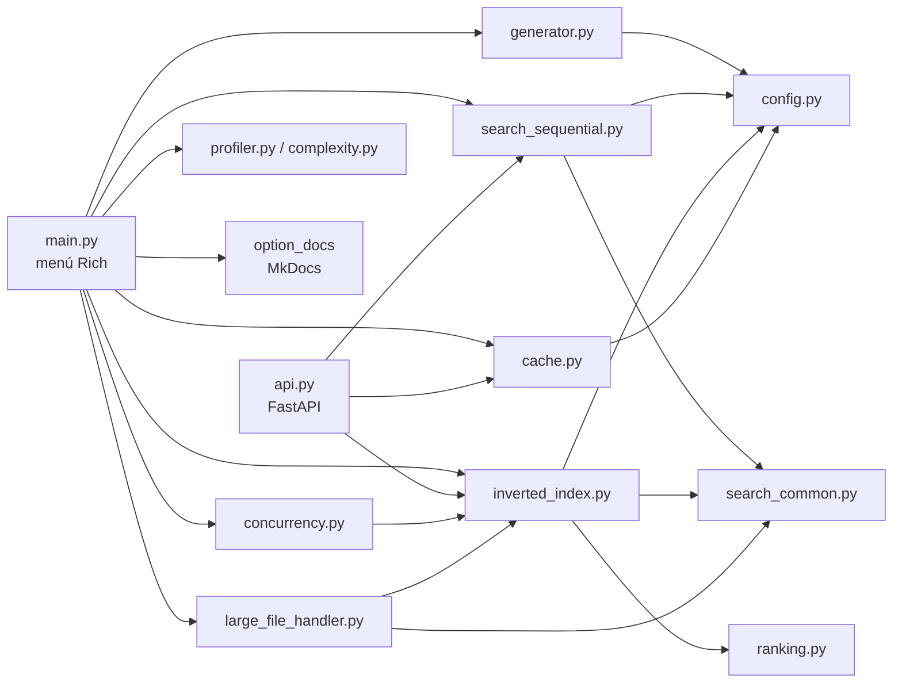
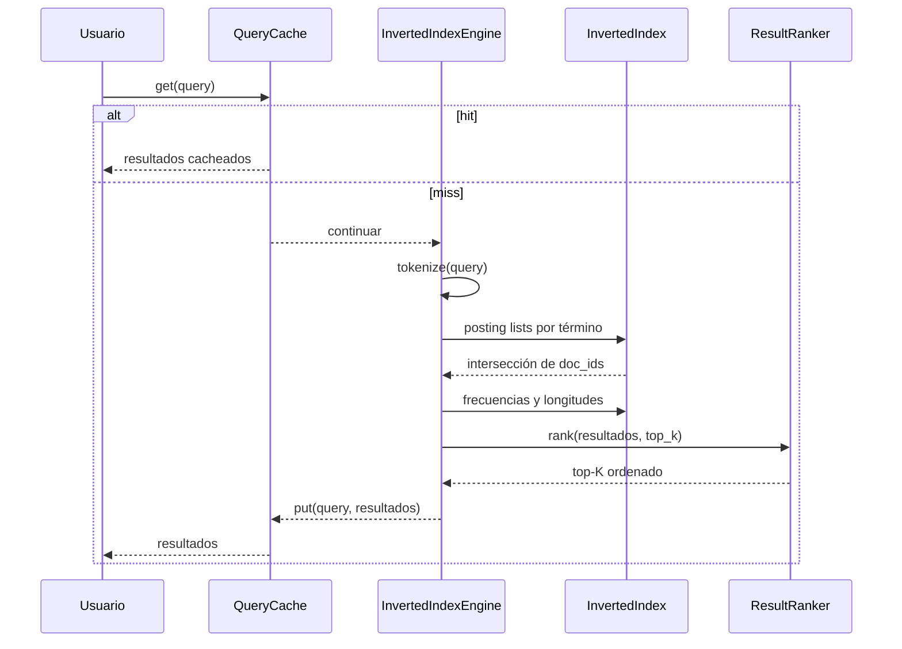
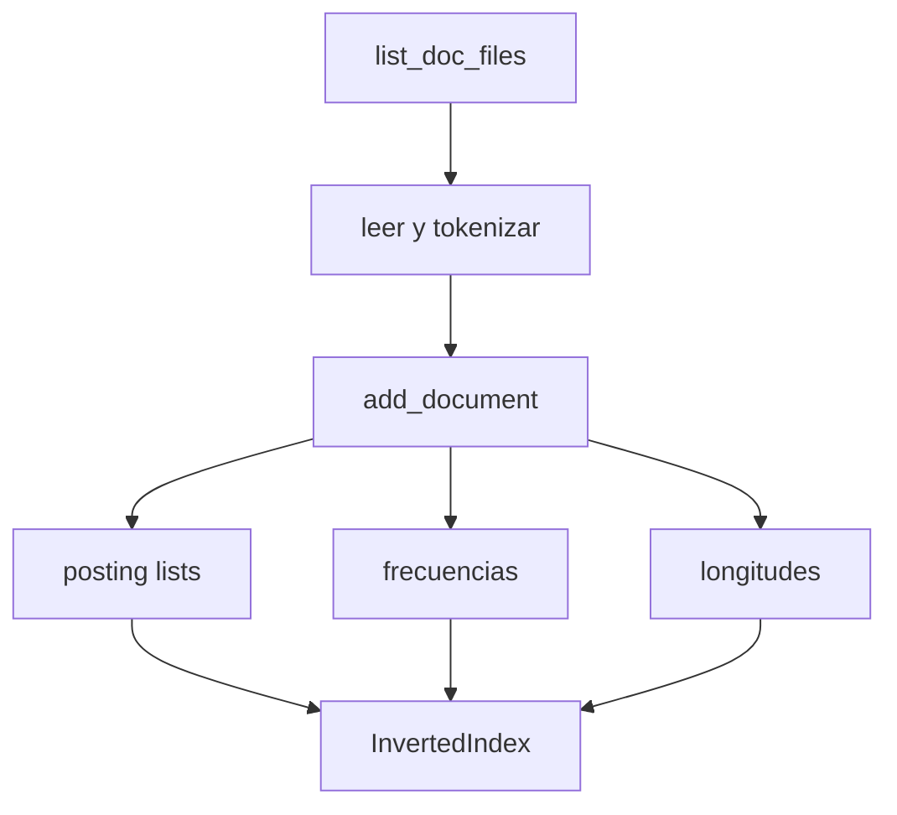
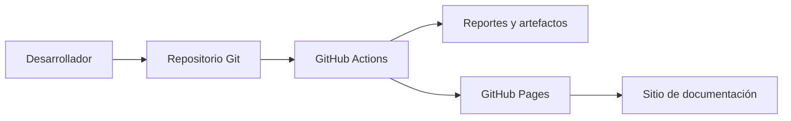

# Arquitectura

## Vista general

El proyecto es una aplicación Python de módulos planos. El núcleo de búsqueda no
depende de la API ni del menú; ambos son adaptadores de entrada.

## Módulos y responsabilidades

| Módulo | Responsabilidad | Depende de |
|---|---|---|
| `config.py` | Constantes: rutas, tamaños, vocabulario, workers. | — |
| `search_common.py` | Tokenización, snippets, IDs, lectura y listado de documentos. | `config` |
| `search_sequential.py` | Motor que recorre y puntúa todos los documentos. | `search_common`, `config` |
| `inverted_index.py` | Índice invertido, posting lists, frecuencias y motor indexado. | `search_common`, `ranking`, `config` |
| `ranking.py` | Selección top-K con heap de mínimo. | `search_common` |
| `cache.py` | Caché LRU de resultados con normalización de consultas. | `config`, `search_common` |
| `concurrency.py` | Búsqueda concurrente y construcción paralela del índice. | `inverted_index`, `search_common` |
| `generator.py` | Corpus sintético reproducible (semilla opcional). | `config` |
| `large_file_handler.py` | Lectura por buffer, batching y pool de procesos. | `inverted_index`, `search_common` |
| `api.py` | Adaptador HTTP con FastAPI. | núcleo |
| `main.py` | Menú interactivo y orquestación. | todos los anteriores |
| `profiler.py`, `complexity.py`, `reporter.py` | Medición y reportes de apoyo. | núcleo |

## Reglas de dependencia

1. `config.py` y `search_common.py` son la base; no importan módulos de negocio.
2. El núcleo (`search_*`, `inverted_index`, `cache`, `ranking`, `concurrency`,
   `large_file_handler`) no importa `api.py` ni `main.py`.
3. `api.py` es un adaptador reemplazable: no contiene lógica de búsqueda.
4. `main.py` orquesta; no implementa algoritmos.
5. Los scripts de CI y benchmarks usan el núcleo, pero no son importados por él.

Estas reglas permiten probar el núcleo sin levantar la API ni el menú.

## Flujo de una búsqueda indexada

## Construcción del índice

## Decisiones arquitectónicas

- [ADR 0001: API FastAPI aislada](adr/0001-fastapi-isolation-strategy.md)
- [ADR 0002: arquitectura para archivos grandes](adr/0002-large-file-architecture.md)
- [ADR 0003: MkDocs Material como documentación externa](adr/0003-mkdocs-documentation.md)
- [ADR 0004: política de calidad y umbrales de CI](adr/0004-ci-quality-gates.md)

## Despliegue local

El pipeline no despliega la aplicación; solo valida, mide y publica
documentación. La API se ejecuta localmente con Uvicorn.
