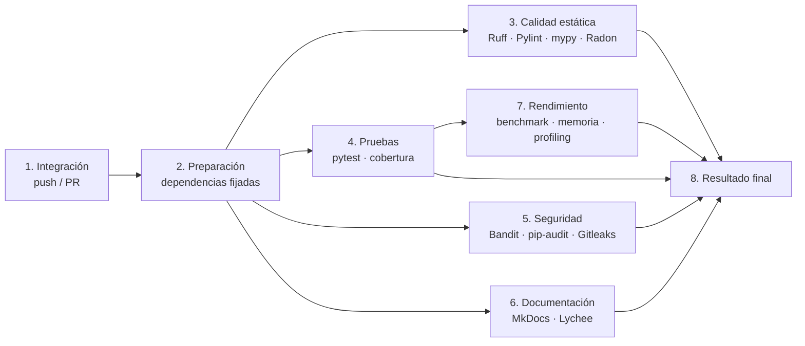

# Integración continua

## Objetivo

El pipeline se ejecuta en cada push y en cada pull request hacia `main`. Ningún
cambio se integra si incumple los umbrales de calidad, seguridad, pruebas,
documentación o rendimiento definidos por el equipo.

## Etapas



Las etapas 3 a 6 corren en paralelo porque no dependen entre sí. Rendimiento
espera a las pruebas para no competir por CPU con la matriz de Python. El
resultado final consolida los artefactos y falla si alguna etapa falló.

## Matriz de controles

| Control | Herramienta | Comando | Reporte | Criterio de rechazo |
|---|---|---|---|---|
| Pruebas | pytest | `pytest -q --junitxml=reports/junit.xml` | JUnit XML | Una o más pruebas fallan. |
| Cobertura | pytest-cov / coverage.py | `pytest --cov --cov-report=xml` | XML + HTML | Cobertura < 80%. |
| Benchmark | pytest-benchmark | `pytest benchmarks --benchmark-json=reports/benchmark.json` | JSON | Regresión > 50% en `main`/schedule. |
| Profiling CPU | cProfile + pyinstrument | `python scripts/profile_cpu.py` | `profile.txt`, `.prof`, HTML | Informativo; se archiva. |
| Análisis estático | Ruff | `ruff check .` / `ruff format --check .` | Anotaciones GitHub | Cualquier violación. |
| Análisis de diseño | Pylint | `pylint --rcfile=.pylintrc ...` | Texto | Score < 8.0. |
| Complejidad | Radon | `python scripts/check_complexity.py` | JSON CC/MI | Bloque ≥ C o MI < 20. |
| Tipado | mypy | `mypy` | Texto | Cualquier error en el núcleo. |
| Memoria | tracemalloc | `python scripts/measure_memory.py` + `check_memory.py` | JSON | > `min(256 MB, 1.5× base)` en `main`. |
| Código inseguro | Bandit | `bandit -r . ... -lll -iii` | JSON | HIGH/HIGH. |
| Dependencias | pip-audit | `pip-audit -r requirements.txt` | JSON | Cualquier CVE en ejecución. |
| Secretos | Gitleaks | `gitleaks git` | SARIF | Cualquier secreto. |
| Documentación | MkDocs | `mkdocs build --strict` | Sitio HTML | El sitio no compila o hay warnings. |
| Enlaces | Lychee | `lychee --offline documentation` | Texto | Enlace interno roto. |

## Jobs del workflow

| Job | Depende de | Contenido |
|---|---|---|
| `preparacion` | — | Instala dependencias fijadas, `pip check`, compila módulos. |
| `calidad-estatica` | `preparacion` | Ruff, formato, mypy, Pylint, Radon. |
| `pruebas-cobertura` | `preparacion` | Matriz Python 3.11/3.12/3.13. |
| `seguridad` | `preparacion` | Bandit, pip-audit, Gitleaks y SARIF de Gitleaks. |
| `documentacion` | `preparacion` | MkDocs strict y Lychee. |
| `rendimiento-memoria` | `pruebas-cobertura` | Benchmarks, memoria y profiling. |
| `resultado-final` | todos | Verifica estados, descarga artefactos y genera resumen. |

## Artefactos

- `reportes-pruebas-<python>`: JUnit, cobertura XML y HTML.
- `reportes-calidad`: Pylint, Radon CC y MI.
- `reportes-seguridad`: Bandit JSON, pip-audit JSON, Gitleaks SARIF.
- `documentacion-html`: sitio MkDocs.
- `reportes-rendimiento`: benchmark JSON, memoria JSON, perfil CPU.
- `resumen-ci`: resumen consolidado.

El SARIF de Gitleaks se intenta subir a GitHub Code Scanning. Si el repositorio
no tiene Code Scanning habilitado, el paso es tolerante a fallos y el reporte
queda igual como artefacto. Bandit se publica como JSON porque su versión actual
no emite SARIF nativo.

## Política de bloqueo

| Condición | Bloquea |
|---|---|
| Prueba fallida | Sí |
| Cobertura < 80% | Sí |
| Ruff con violaciones | Sí |
| Pylint < 8.0 | Sí |
| mypy con errores en el núcleo | Sí |
| Complejidad ≥ C o MI < 20 | Sí |
| Bandit HIGH/HIGH | Sí |
| Secreto detectado | Sí |
| CVE en dependencias de ejecución | Sí |
| Documentación no compila o enlace roto | Sí |
| Benchmark con regresión > 50% en `main` | Sí |
| Memoria fuera de límite en `main` | Sí |
| Benchmark/memoria en PR | No; se informa |

## Ejecución local

El requisito de reproducibilidad se cumple con un único comando:

```bash
make ci
```

o, sin `make`:

```bash
bash scripts/run_ci_locally.sh
```

El script usa exactamente las mismas herramientas, archivos de configuración y
umbrales que CI:

```bash
pip check
python -m compileall -q *.py scripts tests benchmarks
ruff check .
ruff format --check .
mypy
pylint --rcfile=.pylintrc <módulos>
python scripts/check_complexity.py
pytest -q --cov --cov-report=xml:reports/coverage.xml
bandit -r . ... -lll -iii
pip-audit -r requirements.txt
gitleaks git  # o gitleaks dir . si no hay repositorio Git
mkdocs build --strict
lychee --offline --no-progress documentation
pytest benchmarks -q --benchmark-json=reports/benchmark.json
python scripts/check_benchmark.py reports/benchmark.json benchmarks/baseline.json
python scripts/measure_memory.py --output reports/memory.json
python scripts/check_memory.py reports/memory.json benchmarks/memory_baseline.json
python scripts/profile_cpu.py
```

## Protección de la rama `main`

Configurar en GitHub:

1. **Settings → Branches → Add branch protection rule** para `main`.
2. Exigir pull request antes de merge.
3. Exigir que pasen los checks:
   - `Preparación del entorno`
   - `Calidad estática`
   - `Pruebas y cobertura (3.11)`, `(3.12)`, `(3.13)`
   - `Seguridad`
   - `Documentación`
   - `Rendimiento y memoria`
   - `Resultado final`
4. Exigir al menos una revisión.
5. Bloquear force pushes y borrado de la rama.

## Publicación de documentación

`.github/workflows/pages.yml` construye el sitio en cada push a `main` y lo
publica en GitHub Pages. Requiere:

1. Repositorio con GitHub Pages habilitado y fuente **GitHub Actions**.
2. Permisos `pages: write` e `id-token: write` (ya declarados en el workflow).
3. Rama `main` como única fuente de publicación.

## Resolución de fallos

| Fallo | Causa habitual | Acción |
|---|---|---|
| Ruff | Formato o import desordenado | `ruff check --fix .` y `ruff format .` |
| Pylint | Complejidad o diseño | Refactorizar o justificar la excepción. |
| mypy | Anotación faltante o incompatible | Corregir el tipo; no usar `Any` sin justificar. |
| Cobertura | Código nuevo sin pruebas | Agregar pruebas; no bajar el umbral sin justificación. |
| Bandit | Patrón inseguro | Corregir; si es falso positivo, registrar en `SECURITY.md`. |
| pip-audit | Dependencia vulnerable | Actualizar; si no hay fix, excepción documentada. |
| Gitleaks | Secreto | Rotar, eliminar y revisar historial. |
| MkDocs | Enlace o warning | Corregir la página; `mkdocs build --strict` local. |
| Benchmark | Regresión real o ruido | Revisar profiling; regenerar baseline si el cambio es esperado. |
| Memoria | Nuevo uso de memoria | Revisar allocations; ajustar solo con justificación. |
